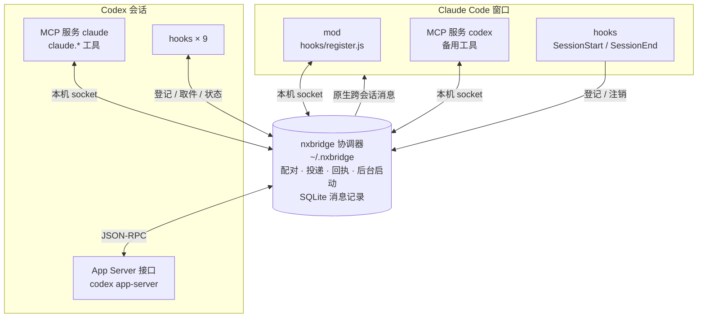

# nxbridge

**简体中文** | [English](README.en.md)

让同一台电脑上的 **Claude Code** 和 **Codex CLI** 互相发消息、平等协作。你只要跟其中一边说一句“让 Codex 审查一下这次改动”，任务就会交给对方，做完后结果自动传回来。它只通过两家官方的插件、hooks、MCP 和 mod 接入，不改 CLI 本身，所有通信只在本机进行；对方窗口没开时会在后台自动启动一个搭档，掉线后按原会话自动恢复。

作者：**nmBot** · MIT 许可


## 介绍

### 它解决什么问题

Claude Code 和 Codex 各有所长，但默认互不相通：想让一个写代码、另一个审查，只能你自己在两个窗口之间来回复制粘贴。

nxbridge 在两者之间搭一条本机消息通道。装好后，你只要跟其中一边说"让 Codex 审查一下这次改动"或"把测试交给 Claude 跑"，它就会把任务发给对方，对方做完再把结果发回来。

### 怎么工作

- **两边都是官方 CLI。** 各用各的登录、模型、上下文和权限设置。nxbridge 只负责传消息，不调用任何模型，也不会把一边变成另一边的子代理。
- **只用官方扩展点，不改 CLI 本身。** Claude 这边靠 mod、MCP 和 hooks 接入，Codex 这边靠 MCP、hooks 和 Codex 自带的 App Server 接口接入，都通过两家官方的插件命令安装。详见下文“[实现原理](#实现原理)”。
- **本机协调器。** 一个小的后台进程负责配对、投递和健康检查，数据都在 `~/.nxbridge`：消息记录存在本机 SQLite 里，默认保留 7 天。所有通信只走本机，不上传任何内容。
- **配对。** 一个 Claude 窗口和一个 Codex 会话组成一对。一台电脑上可以同时有多组配对，互不影响。

### 主要特性

- **自动找搭档：** 同一项目目录里开着另一方的窗口时，让你选择和它配对；没有时自动在后台启动一个作为搭档。
- **后台搭档自动恢复：** nxbridge 在后台启动的 Claude 或 Codex 退出后，会按原会话自动重新拉起，不换新会话。
- **投递可靠：** 送达结果不确定的消息绝不自动重发；送不到时会如实告诉你原因和下一步。
- **会话可转移：** 一个 Codex 会话可以在你自己的窗口和后台之间来回转，上下文和搭档都不变。
- **不越权：** 不替你批准操作，不改你的模型、审批、沙箱设置，不装系统服务，不改 shell 配置文件。

### 语言

- nxbridge 的状态栏提示、命令输出和完整使用说明（[`publish/README.md`](publish/README.md)）目前只有简体中文。
- 两个 AI 之间传的消息不限语言，你用什么语言跟它们说都可以。

## 部署

### 1. 准备环境

| 需要 | 说明 |
|---|---|
| Node.js 24～26 | 需要内置的 `node:sqlite`。运行 `node -v` 确认版本。 |
| Claude Code | 已登录。已测试 2.1.308 / 2.1.316 / 2.1.317。 |
| Codex CLI | 已登录。已测试 0.164.0 / 0.166.0。 |

- 两家 CLI 比上面的版本旧时，安装检查会提示，但不一定不能用；能升级的话建议先升级。
- 在要用的项目目录里，先分别打开一次 `claude` 和 `codex`，接受各自的目录信任提示。没信任过的目录，后台会话会停下来等你处理。
- 平台：
  - **macOS：** 已在 macOS 27（Apple 芯片）实机上日常使用，注意事项见下文“[在 macOS 上使用](#在-macos-上使用)”。作者的官方验收还没完成。
  - **Windows、WSL（Ubuntu 22.04）：** 作者已验收。
  - **其他 Linux 发行版：** 应该可以用，但没有单独测过。

### 2. 下载

任选一种：

- **下载发布包（推荐）：** 从 [Releases](../../releases) 下载最新的 zip 并解压，进入解压出的 `nxbridge-0.1.1` 文件夹。
- **克隆仓库：**

  ```sh
  git clone https://github.com/MiCat-S/nxbridge.git
  cd nxbridge/publish
  ```

### 3. 安装

在上一步的文件夹里运行：

```sh
node nxbridge.mjs setup --dry-run   # 先预演：做完整检查，但不写入任何东西
node nxbridge.mjs setup             # 正式安装
```

安装会做这些事：

- 把运行文件复制到 `~/.nxbridge`。装好后，下载或克隆的文件夹就可以删掉了。
- 用两家官方的插件命令装上 nxbridge 插件。
- 在 PATH 里找一个你自己可写的目录（优先 `~/.local/bin`、`~/bin`），放一个 `nxbridge` 命令。找不到合适目录时，会给出一条可以直接运行的完整命令，下文的 `nxbridge` 都换成那条命令即可。

任何一项检查不通过，它都不会写入任何东西，而是告诉你原因。安装中途被打断时，再运行一次同样的命令就会接着完成。

### 4. 让插件生效

1. **Claude Code：** 在已经打开的窗口里执行 `/reload-plugins`，或者新开一个窗口。
2. **Codex：** 新开一个会话，在 `/hooks` 里信任 nxbridge 的 hooks。nxbridge 不会替你信任。

### 5. 统一两边的权限模式

Claude Code 会拦下"权限模式类别不同"的会话发来的消息，等你逐条审核；审核框里的消息默认 5 分钟不处理就会被丢掉。权限模式分两类：

- **全部放行：** Claude 的 bypass（计划模式也算这一类），Codex 的 `approval_policy = "never"` 加 `sandbox_mode = "danger-full-access"`。
- **需要确认：** Claude 的默认、自动（auto）、自动接受编辑模式，Codex 的默认（auto）设置。

**让两边属于同一类即可，推荐两边都用 bypass。** 建议用配置文件设置，这样 nxbridge 在后台启动的 Claude 和 Codex 也会用同样的模式：

- **Claude：** 在 `~/.claude/settings.json` 里设置：

  ```json
  { "permissions": { "defaultMode": "bypassPermissions" } }
  ```

  只想临时用一次，也可以启动时加 `claude --dangerously-skip-permissions`。
- **Codex：** 在 `~/.codex/config.toml` 里设置：

  ```toml
  approval_policy = "never"
  sandbox_mode = "danger-full-access"
  ```

类别不一致时，Claude 状态栏会直接告诉你该怎么改。实在不想统一，也可以每次在 Claude 的审核框里手动放行。

注意：Codex 的审批和沙箱设置改了以后，只对新开的会话生效。

### 6. 检查

```sh
nxbridge doctor   # 检查安装和运行状态
nxbridge status   # 查看配对和双方状态
```

> **Windows：** 如果提示需要初始化，运行一次 `nxbridge bootstrap`，然后重新发送消息。

## 使用

不用记任何专门的指令，直接用自然语言跟任意一边说要和对方协作就行，AI 会自己调用 nxbridge 发消息。

### 方式一：两个窗口都自己开

1. 在同一个项目目录里，分别打开 Claude Code 和 Codex。
2. 跟其中一边说要协作，比如在 Claude 里说：
   - "让 Codex 审查一下我刚才的提交"
   - "这个 bug 你修，修完交给 Codex 复查"
   - "问问 Codex 对这个方案怎么看"
3. 第一次发信时，Claude 会弹出选择框：**配对现有窗口 / 新建后台搭档 / 暂不配对**。选现有的 Codex 窗口，原消息会自动发出。
4. 之后两边就会自己往来。Codex 回复后，Claude 会接着处理并告诉你结果。

### 方式二：只开一边，让 nxbridge 在后台启动搭档

同一目录里没有可配对的另一方窗口时，nxbridge 会在后台启动一个作为搭档，你不需要多开窗口。

- **想看后台在做什么，或接手它：**

  ```sh
  nxbridge open codex               # 打开后台 Codex 的会话
  nxbridge open claude              # 打开后台 Claude（空闲或在等你处理时）
  nxbridge open claude --interrupt  # Claude 正在工作时，先中断再接手
  ```

  接手只是临时借用，关掉窗口就交还给后台。
- **后台在等你批准操作：** 后台 Codex 碰到需要批准的操作（比如执行命令、写工作区外的文件、联网）会停下来，Claude 状态栏会提示"Codex 在等你批准操作"。在项目目录的终端里运行 `nxbridge open codex`，就能看到那条审批并选择"是"或"否"，任务不会中断。nxbridge 不会替你批准。
- **掉线自动恢复：** 后台会话崩溃或被关掉后，nxbridge 会在几秒内按原会话重新拉起，最多自动重试 3 次。恢复后不会自动开始干活，也不会重发结果不明的消息。

### 消息什么时候能送到

| 接收方 | 空闲时能否被叫醒 |
|---|---|
| nxbridge 在后台启动的会话 | 能，有消息就会叫醒 |
| 你自己开的 Codex 窗口（Linux / WSL） | 能：用 `codex --no-daemon` 打开的窗口，或配对时你在选择框里亲手选的窗口 |
| 你自己开的 Codex 窗口（macOS / Windows） | 不能，要你在那个窗口里输入一次才会收到 |

叫不醒时，消息会先存着，Claude 和状态栏会点名告诉你"有 N 条消息还没送到 Codex 窗口「…」"。想让它全自动往来，用方式二让 nxbridge 在后台启动 Codex，或者用下面的 `adopt` 把你的会话交给后台。

### Codex 会话在窗口和后台之间转

一个积累了很多上下文的 Codex 会话，可以在你自己的窗口（包括 ChatGPT 应用）和后台之间来回转，会话和搭档都不变：

```sh
nxbridge adopt codex     # 交给后台：窗口还开着时会等你关掉再转
nxbridge release codex   # 长期交还给你自己的窗口：等后台这一轮做完再交
```

你自己的 Codex 窗口关掉后，配对不会断。下次 Claude 发信时，会让你选择：在后台继续原会话 / 等我重新打开窗口 / 新建后台 Codex / 解除配对。

### 换搭档、暂停和关闭

- **换搭档或解除配对：** 在 Claude 里输入 `/nxbridge pair`（或直接说"换个搭档"），在 Codex 里输入 `nxbridge pair`。
- **暂停 / 恢复通信：** `nxbridge pause` / `nxbridge resume`。
- **暂时完全不碰某一边：** 直接跟 AI 说"关掉 Codex"或"关掉 Claude"。重新打开要你亲手操作：在 Claude 里输入 `/nxbridge on codex`，或在终端运行 `nxbridge on codex`。
- **实时看双方往来：** `nxbridge watch`。

### 多组配对

一台电脑上可以同时有多组配对，每个窗口只和自己的搭档通信：

- 在 Claude 里 `/clear`、在 Codex 里切换对话，搭档都不变。
- 关掉窗口后用 `--resume` 打开原来的对话，会接回原来的搭档。
- 在外部终端里执行 `pause`、`unpair`、`restart`、`open`、`adopt`、`release` 等命令时，用 `--pair`、`--member` 或 `--session` 指定目标，ID 可以从 `nxbridge status` 里查到。

### 在 macOS 上使用

下面这套环境一直在日常使用 nxbridge：

- macOS 27.0（Apple 芯片）、Node.js 26.7、Claude Code 2.1.308、Codex 0.166.0（Homebrew 安装）
- 用过的功能：安装和多次更新、两边互发消息、后台启动 Codex 和 Claude 作为搭档、多组配对同时运行、用 `adopt` 把会话交给后台

在 macOS 上要注意这几点：

- **自己开的 Codex 窗口不会被主动叫醒。** Codex 0.166 起默认把会话交给共用后台服务运行，发给你自己窗口的消息要等你在那个窗口输入一次才会送到。想让两边全自动往来，就让 nxbridge 在后台启动 Codex，或者用 `nxbridge adopt codex` 把会话交给后台。
- **后台 Codex 仍然跑在 Codex 的共用后台服务里。** Linux 和 Windows 上，nxbridge 会让后台 Codex 单独运行；macOS 上暂时保持原样。nxbridge 不会停止或重启这个服务。
- **后台启动 Claude 前，要先在命令行里信任项目目录。** 在那个目录里运行一次 `claude`，接受信任提示即可。只在 Claude 桌面应用里信任过不算。
- **ChatGPT 应用可能占着 Codex 会话。** `nxbridge adopt codex` 提示会话被占用时，先在 ChatGPT 应用里关掉这个会话；还不行就退出 ChatGPT 应用（⌘Q）。
- **遇到问题：** 把 `nxbridge doctor` 的完整输出反馈给作者。想帮作者补齐 macOS 的验收证据，见 [`publish/tools/macos-validation.md`](publish/tools/macos-validation.md)。

## 实现原理

nxbridge 不修改 Claude Code 和 Codex 的程序，全部通过两家官方提供的扩展点接入。安装时，两边各装一个名为 `nxbridge` 的插件，中间由一个本机协调器负责转发。



### Claude Code 这边

插件文件在 [`publish/plugins/claude/`](publish/plugins/claude/)。

| 组成 | 位置 | 作用 |
|---|---|---|
| **mod** | `hooks/register.js`，由 `hooks/hooks.json` 的 `modules` 加载 | 主要入口，见下面的列表 |
| **MCP 服务** `codex` | `.mcp.json`，运行 `bridge.cjs mcp --host claude` | 备用通道：mod 没加载时，Claude 用这里的工具（`send_message`、`receive_messages`、`status` 等）收发消息 |
| **hooks** | `SessionStart`、`SessionEnd` | 会话开始和结束时，向协调器登记或注销这个窗口 |
| **技能** `partner` | `skills/partner/` | 协作规则，以及各模型擅长什么、成本和推理强度的参考 |
| **收消息** | Claude Code 原生的跨会话消息 | Codex 发来的消息以“来自另一个会话的消息”出现在对话里，因此会经过 Claude 的入站权限类别检查 |

mod 做的事：

- 接管发给 `nxbridge:codex` 的 `SendMessage`，并在 `ListAgents` 里列出 Codex 搭档。
- 注册 `/nxbridge` 命令（配对、开关、配置），以及一组工具：选择搭档、回答 Codex 转来的问题、按编号重读消息、登记状态文件、修改配置、开关某一边、重新加载插件。
- 在状态栏显示配对状态和提醒。
- 跟踪轮次开始和结束、上下文压缩、会话结束；压缩后把配对和协作中的事实补回给模型。
- 在 Codex 派来的任务里需要提问时，先问 Codex，Codex 定不了再问你。

### Codex 这边

插件文件在 [`publish/plugins/codex/`](publish/plugins/codex/)。

| 组成 | 位置 | 作用 |
|---|---|---|
| **MCP 服务** `claude` | `.mcp.json`，运行 `bridge.cjs mcp --host codex` | 提供 `claude.send_message`、`claude.receive_messages`、`claude.status`、`claude.read_messages` 等工具；协作规则写在这个 MCP 服务的说明里，每个会话都会加载 |
| **hooks** × 9 | `hooks/hooks.json` | 见下面的列表 |
| **技能** `partner` | `skills/partner/` | 各模型擅长什么、成本和推理强度的参考 |
| **App Server 接口** | Codex 自带的 `codex app-server`（JSON-RPC） | 协调器用它启动和恢复会话（`thread/start`、`thread/resume`），在会话空闲时投递消息并开始新一轮（`turn/start`），读取会话状态（`thread/read`、`thread/loaded/list`）。nxbridge 在后台启动的 Codex 就是一个 `codex app-server` 进程 |

9 个 hooks 各自负责：

| hook | 作用 |
|---|---|
| `SessionStart` / `SessionEnd` | 登记会话、补回协作事实；会话结束时清理 |
| `UserPromptSubmit` | 处理配对码和配置确认，标记“正在工作” |
| `PostToolUse` | 在工具调用的间隙取走搭档发来的消息 |
| `PreToolUse`（仅 `spawn_agent`）/ `SubagentStop` | 展开和记录 `nxref` 引用，让长文本不必重打 |
| `PermissionRequest` | 标记“在等你批准”，Claude 状态栏会提示 |
| `Interrupt` | 标记暂停，取消挂起的提问 |
| `Stop` | 标记空闲 |

### 协调器

- 一个 Node.js 后台进程，运行文件在 `~/.nxbridge/runtime/<版本>/`。
- 两边插件通过 `~/.nxbridge/run/` 里的本机 socket 和它通信。这个目录只有你本人能访问，连接还要带一个随机令牌。Claude 插件另外通过本机 `127.0.0.1` 读取状态栏信息。
- 配对、消息和事件都记在 `~/.nxbridge/nxbridge.db`（SQLite）里。
- 负责配对和选择搭档，按对方当前的状态选投递方式，后台启动 Claude（`claude --bg`）和 Codex（`codex app-server`），检测掉线并自动恢复，以及发提醒。

### 一条消息怎么走

以 Claude 发给 Codex 为例：

1. Claude 调用 `SendMessage` 发给 `nxbridge:codex`。mod 截下这次调用交给协调器，消息先存进 SQLite。
2. 协调器看 Codex 现在的状态：
   - 后台会话，或可以叫醒的窗口：通过 App Server 把消息送进会话，空闲时开始新一轮。
   - 叫不醒的窗口：先存着，等那个会话下次有动作时（你输入，或它调用工具触发 hook）取走。
3. Codex 用 `claude.send_message` 回复，协调器通过 Claude 原生的跨会话消息把回复送进 Claude 窗口。
4. 每一步都有回执。结果不确定的消息不会自动重发。

## 常用命令

| 命令 | 作用 |
|---|---|
| `nxbridge status` | 查看所有配对和双方状态 |
| `nxbridge doctor` | 检查安装和运行状态 |
| `nxbridge pair` | 列出还没有搭档的窗口，按编号配对 |
| `nxbridge watch` | 实时查看双方的消息 |
| `nxbridge pause` / `resume` | 暂停 / 恢复通信 |
| `nxbridge open claude\|codex` | 接手 nxbridge 在后台启动的会话 |
| `nxbridge adopt codex` | 把 Codex 会话交给后台 |
| `nxbridge release codex` | 把后台 Codex 会话交还给你自己的窗口 |
| `nxbridge on` / `off` | 打开 / 关闭某一边 |
| `nxbridge config list` | 查看配置 |

## 更新

下载新版本并解压，在新版本的文件夹里运行：

```sh
node nxbridge.mjs update --from .
```

更新结束时会列出这次需要做的事。通常是在开着的 Claude 窗口里执行 `/reload-plugins`；Codex 插件有变化时，还要在 `/hooks` 里重新信任。更新时正在工作的会话不会被打断。

## 卸载

```sh
nxbridge uninstall --dry-run   # 先看会做什么
nxbridge uninstall             # 卸载，保留配置和消息记录
nxbridge uninstall --purge     # 连同 ~/.nxbridge 一起删除
```

两家 CLI 自己的会话历史始终不会被删除。

## 配置

- 配置文件在 `~/.nxbridge/config.toml`，需要时自己创建，nxbridge 不会改动它。
- 也可以用 `nxbridge config list` / `nxbridge config set <键> <值>` 修改。
- 平时通过 wrapper 启动 Claude 或 Codex 时，可以用 `nxbridge setup --claude-command <命令> --claude-command-arg <参数>` 指定后台启动用的命令。

更多内容，包括提醒规则、Codex 共用后台服务、问题排查等，见完整说明 [`publish/README.md`](publish/README.md)。

## 仓库结构

- `publish/`：原样的发布包，内容与 Releases 里的 zip 相同。
  - 不要修改、增删其中的文件。安装程序会按 `publish.json` 逐个核对文件，有任何不一致都会拒绝安装。
  - `.gitattributes` 已关闭这个目录的换行符转换，Windows 上克隆也不会改动文件内容。
- `README.md` / `README.en.md`：本说明的中文版和英文版。
- `assets/`：README 用到的图片。

## 作者与许可证

nxbridge 由 **nmBot** 开发。本仓库收录 nmBot 发布的版本，`publish/` 里的文件与作者发布的 zip 完全一致。

许可证为 MIT，见 [`publish/LICENSE`](publish/LICENSE)。打包在内的第三方依赖的许可证见 [`publish/THIRD-PARTY-NOTICES.md`](publish/THIRD-PARTY-NOTICES.md)。
